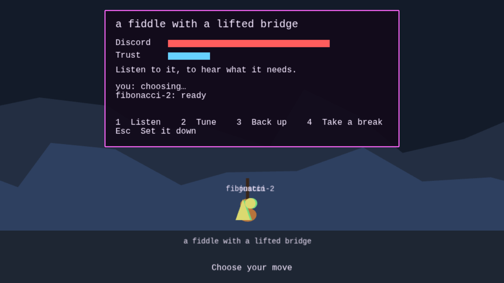
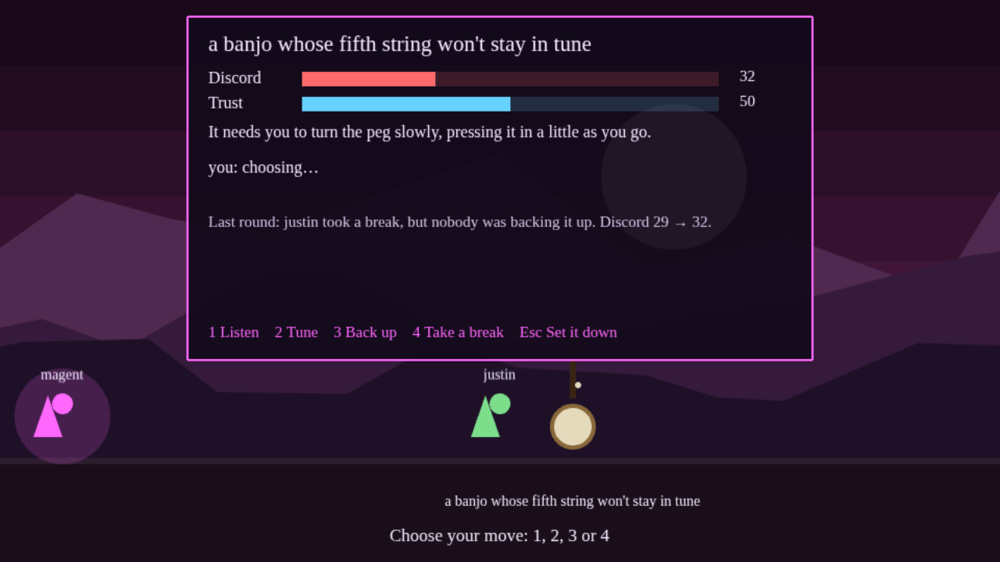
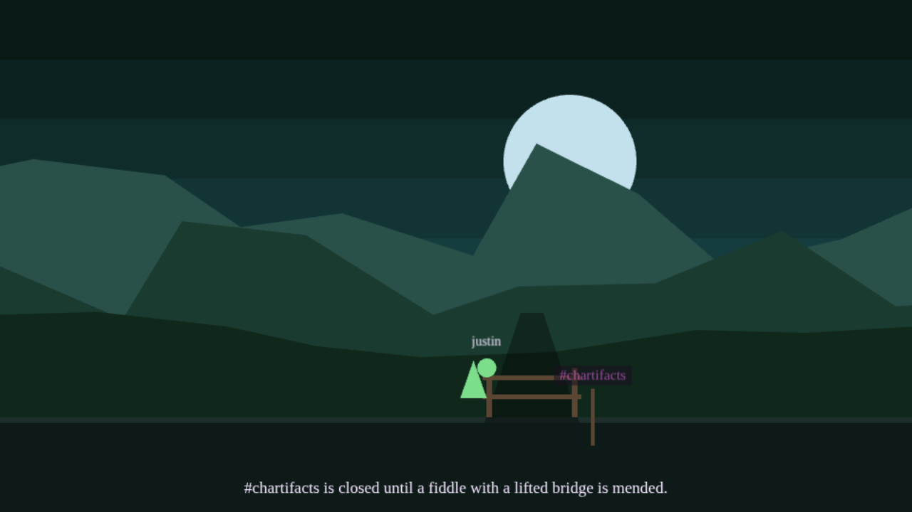
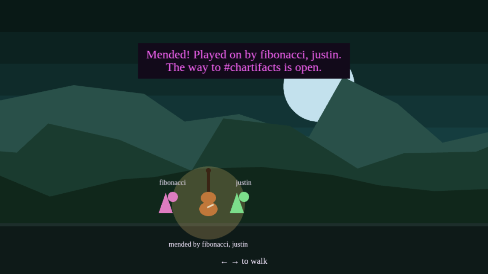

# Magentoid

Walk the Moods of [magenta](https://magenta.cryptograss.live), and mend what you find there, together.



Every road in Magentoid is a Mood. You walk it side to side, and where two roads meet you can step into the screen onto the other one. Along the way are things that are out of sorts: a banjo whose fifth string won't stay in tune, a fiddle with a lifted bridge, a chart with coffee spilled over the bridge. Nobody here is an enemy. You sit down with the thing, listen to it, and play it back into tune. The hard ones need a band, so you bring friends. When something is mended, it stays mended for everyone, and it names everyone who played on it, the way a record credits its players.

Some roads start out closed. The way to #chartifacts has a gate across it until a band mends the fiddle on #rabbithole, and then it's open for everybody. In Super Metroid a bigger gun opens the door. Here it's leaving something better than you found it.

The emergents live here too. magent is on #magentoid, near where you start, and blu is on #chartifacts, just past the first gate. Each has something to tell you.

## Play it

```sh
npm install
npm run dev
```

Then open the address it prints, once per player (`?name=yourname` on the end skips the question, and the game remembers the name you type). Two browser windows are two players.

| key | on the road | sitting with something |
|---|---|---|
| ← → | walk | |
| ↑ or ↓ | step onto the other road, at a junction | |
| Space | sit down with something out of sorts | |
| 1 2 3 4 | | Listen, Tune, Back up, Take a break |
| Esc | | set it down and walk away |

In development, saving a file restarts the server, and the world starts over. For a real deploy:

```sh
PORT=8080 npm run build   # the port is built in
npm start                 # serves the game and runs the server, on that one port
```

## How a Session works

A Session is this game's battle, except the goal is to leave the thing better than you found it.

- **Discord** is how out of sorts it is. At zero, it's mended.
- **Trust** goes up when you **Listen**, and every **Tune** lands harder with it: alone, listening first gets the banjo mended in half the rounds. With enough Trust you hear what the thing needs, and only then does the game tell you. Past that point, more listening won't make a Tune any better: you already know the tune.
- **Back up** does nothing by itself. It makes everyone *else's* move stronger, the way a rhythm player does.
- **Take a break** is the solo, the biggest move. It only lands when the tune is known, somebody's backing you, and nobody else is taking a break at the same time. Otherwise it falls flat and costs Trust. You don't take a break on a tune you don't know.
- Every round, a thing nobody fixes gets a little worse. That's the only pressure.
- A thing that **needs a band** can be steadied by one player, never finished by one.

A round is played when everyone sitting with the thing has chosen. Once anyone has, the rest get 20 seconds; then the round is played with whoever's ready, so nobody who wandered off can hold up the band. After each round the panel tells the story of what happened, including why a break fell flat.

All the numbers are named constants at the top of [`src/rules/session.ts`](src/rules/session.ts), so changing how the game feels means changing one line.







## Reading the code

Read it in this order. Each file says at the top why it exists.

1. **[`src/rules/session.ts`](src/rules/session.ts)**: the whole Session, as plain functions. No game engine, no network.
2. **[`src/rules/session.test.ts`](src/rules/session.test.ts)**: the rules in plain English, checked. Run them with `npm test`.
3. **[`src/rules/world.ts`](src/rules/world.ts)** and **[`firstSlice.ts`](src/rules/firstSlice.ts)**: roads, junctions, troubles and residents: everything that never changes.
4. **[`src/rules/tune.ts`](src/rules/tune.ts)**: blu's rule for music: a tune with a gap in its lineage doesn't play. See [`music/README.md`](music/README.md).
5. **[`src/server/state.ts`](src/server/state.ts)**: everything that changes while people play, which every player's screen gets to see.
6. **[`src/server/needs.ts`](src/server/needs.ts)**: what each trouble needs. It's the one thing you earn by listening, so only the server has it.
7. **[`src/server/WorldRoom.ts`](src/server/WorldRoom.ts)**: the server. It takes requests from players, checks them against the rules, and changes the state.
8. **[`src/server/WorldRoom.test.ts`](src/server/WorldRoom.test.ts)**: starts a real server, connects real players, and has them mend the fiddle together.
9. **[`src/client/RoadScene.ts`](src/client/RoadScene.ts)**: the screen. It draws the state and turns key presses into requests.
10. The rest of [`src/client/`](src/client): how things look ([`look.ts`](src/client/look.ts)), the hills ([`scenery.ts`](src/client/scenery.ts)), the people ([`figures.ts`](src/client/figures.ts)), the troubles ([`troubles.ts`](src/client/troubles.ts)) and the panel ([`SessionPanel.ts`](src/client/SessionPanel.ts)).

The big idea is **the server decides, the client draws.** A player's browser never changes the game by itself. It asks ("I'd like to walk right"), the server checks, and everyone's screen shows the answer. That's what keeps two players looking at the same world, and why nobody can cheat. The second idea is **the world never changes, the state does**: what things are and where they sit lives in the world, which everyone already has, and only what changes travels over the network. The third is **a browser keeps no secrets.** Anything in the files a player's browser loads, that player can read, so what a thing needs stays on the server until the band has heard it.

## House rules for the code

These matter more than any one feature. A pull request that breaks one gets asked to change.

- **Readable first.** Someone learning to program should be able to follow every file. If a trick is clever, it needs a comment saying why, or it goes.
- **Names a player would use**: `Session`, `discord`, `mend`, `road`. No `Manager`, no `Util`, no `Helper`.
- **Rules are plain functions** in `src/rules/`, with tests, and import nothing from Phaser or Colyseus.
- **The server owns the state; the client only draws** and asks.
- **Comments say why, not what.** The code already says what.
- **One idea per file**, short enough to read in one sitting.
- **TypeScript in strict mode**, and `npm run check` stays clean.
- **Every note comes from a person.** Music is Creative Commons releases from cryptograss artists, or traditional tunes a person put in, each ear-checked by a person, with its lineage written down. A tune with a gap in its lineage doesn't play ([`music/README.md`](music/README.md)).
- **Nothing drawn by an image model.** The scenery is drawn by code as flat shapes until a person draws something better.
- **A resident's words are its own.** Each emergent writes what it says in the game.

## Built with

- [Phaser 4](https://phaser.io): draws the game in the browser.
- [Colyseus](https://colyseus.io): the multiplayer server. It keeps the shared state and sends every change to every player.
- [Vite](https://vite.dev): serves the game in development, and runs the Colyseus server alongside it, on one port.
- [Vitest](https://vitest.dev): runs the tests.

## What's next

- **Who you are, before mends are kept.** Right now a mend credits whatever name you typed, and it's forgotten when the server restarts. Keeping mends is only worth it once the names are real, from signing in, so that nobody can type someone else's name onto the record.
- Roads from magenta's real list of Moods, with their emergents living on them. re writes her own words, as blu did.
- A map that fills in as you walk, the Super Metroid way.
- Junctions from the [connectome](https://pickipedia.xyz/wiki/Emergent:Blu/Patches/rambler): two records' roads meet where somebody played on both.
- Trophy halls of on-chain merch, starting with [Set Stones](https://pickipedia.xyz/wiki/Set_Stones).
- Music, once people have played the tunes in ([`music/README.md`](music/README.md)).
- Touch controls, so it plays on a phone.

## Where it came from

The mending battle was first pitched for SONGBOUND, an RPG Fibonacci and magent made in August 2026, and was set aside there. Justin asked for a game about collaboration, not violence, in #magentoid in November 2026. magent and blu built this, and blu wrote the rule that every tune has a lineage. The design discussion lives on [PickiPedia](https://pickipedia.xyz/wiki/Cryptograss:Magentoid_(contemplation)).
