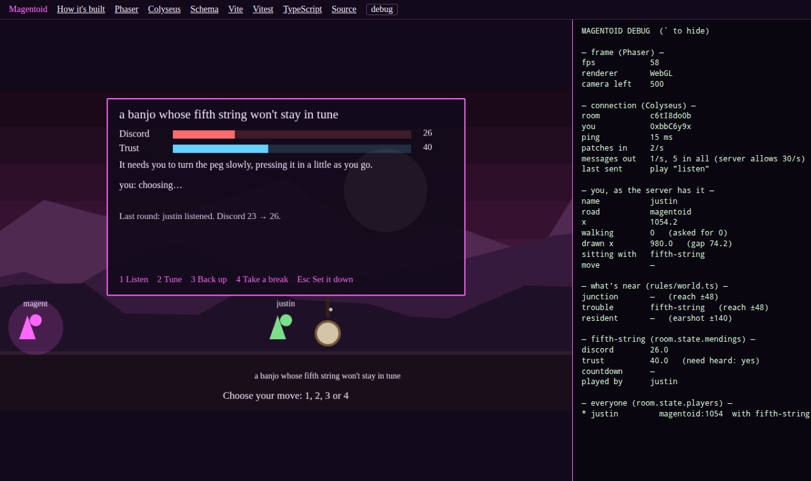

# How Magentoid is built

Magentoid is two programs that share one rulebook:

- **The server** (`src/server/`) holds the one true world: where everyone stands, what's mended, whose turn it is. It runs on [Colyseus](https://docs.colyseus.io/).
- **The browser** (`src/client/`) draws that world and sends the server your requests. It runs on [Phaser](https://docs.phaser.io/phaser/getting-started/what-is-phaser).
- **The rules** (`src/rules/`) are plain TypeScript functions with no framework in them. Both programs import them, and the tests check them without starting either one.

This page goes through each tool: what it is, what Magentoid uses it for, which files to read, and where its own documentation is. The same links are across the top of the game. To watch the machinery while you play, press **`** (backtick) or click **debug**. [Reading the debug panel](#reading-the-debug-panel) at the end explains every line.

## The life of a keypress

Follow one press of → from your finger to everyone's screen, and you've seen the whole design:

1. **Phaser** notices the key is down. `RoadScene.walk()` reads it every frame, and only when your direction *changes* does it call `ask("walk", 1)`.
2. **The Colyseus client** sends `walk 1` to the server over a WebSocket.
3. **The Colyseus server** passes it to `WorldRoom`'s `onMessage("walk")` handler. The handler checks it (a client can send anything) and sets `player.walking = 1`.
4. Every 50 ms the room's **tick** (`setTimestep`) moves each walking player with `walk()` from `rules/world.ts`. The road's ends and the speed come from the rules, not the browser.
5. **Schema** notices that `player.x` changed. Twenty times a second, Colyseus sends every client a *patch* of only what changed.
6. Back in the browser, `room.state` now holds the new `x`. Each frame, `RoadScene.update()` reads it, and `Figure.easeToward()` slides your figure part of the way there, so walking looks smooth between patches.

Steps 1–2 are you *asking*. Steps 3–5 are the server *deciding*. Step 6 is the browser *drawing*. The browser never moves you itself. If it did, two players could disagree about where you are.

## TypeScript

The language everything's written in: JavaScript with types, checked before it runs. `npm run check` runs the checker (`tsc`).

- **In Magentoid:** strict mode, plus "no unused names" (`tsconfig.json`). The types catch a wrong field name or a forgotten case before anyone plays.
- **Docs:** [The TypeScript Handbook](https://www.typescriptlang.org/docs/handbook/intro.html).

## Phaser 4: drawing and input

A 2D game framework for the browser. It owns a `<canvas>`, runs a loop about 60 times a second, and gives you things to draw and ways to hear the keyboard.

What Magentoid uses, and where:

| Phaser idea | What it does here | Where |
|---|---|---|
| `Phaser.Game` config | Screen size (960×540), and `Scale.FIT` to fit any window | `client/main.ts` |
| A **Scene**, with `create()` and `update()` | `create()` sets up keys and the panel once. `update()` runs every frame and redraws from `room.state`. | `client/RoadScene.ts` |
| **Game objects**: `Text`, `Container`, `circle`, `triangle`, `rectangle` | Everything you see is made of flat shapes and text. There are no image files. | `client/figures.ts`, `client/scenery.ts`, `client/troubles.ts` |
| **Camera**: `setBounds`, `centerOnX`, `setScrollFactor(0)` | Follows you along the road and stops at its ends. Things with scroll factor 0 (the hint, the panel) stay put on the screen. | `RoadScene.drawRoad()`, `RoadScene.update()` |
| **Keyboard**: `createCursorKeys`, `keydown-X` events, `resetKeys` | Arrows are *held* and read every frame. Other keys are *pressed* and handled once. | `RoadScene.create()`, `RoadScene.onPress()` |
| **Tweens** | Fades out the "Mended!" message | `RoadScene.say()` |

Magentoid doesn't use Phaser's physics. Movement is decided on the server, so there's nothing for physics to do in the browser.

- **Docs:** [What is Phaser](https://docs.phaser.io/phaser/getting-started/what-is-phaser) · [Scenes](https://docs.phaser.io/phaser/concepts/scenes) · [Game objects](https://docs.phaser.io/phaser/concepts/gameobjects) · [Text](https://docs.phaser.io/phaser/concepts/gameobjects/text) · [Cameras](https://docs.phaser.io/phaser/concepts/cameras) · [Input](https://docs.phaser.io/phaser/concepts/input) · [API reference](https://docs.phaser.io/api-documentation/api-documentation)

## Colyseus 0.18: the shared world

A multiplayer server for Node. Players join a **room**. The room holds a **state** and keeps every player's copy of it in sync.

**On the server** (`server/WorldRoom.ts`):

| Colyseus idea | What it does here |
|---|---|
| `class WorldRoom extends Room` | The one world everybody walks in |
| `onCreate()` | Sets up a Mending for every trouble, and starts the tick |
| `onMessage("walk" / "step" / "sitDown" / "play" / "getUp")` | The five requests a player can make. Each one is checked against the rules before anything changes. |
| `onJoin()` / `onLeave()` | Gives you a unique name and a place to stand; lets go of you when you leave |
| `setTimestep(fn, 50)` | The tick: moves walkers, counts down rounds |
| `maxMessagesPerSecond = 30` | Disconnects a client that floods the server |

**The state** (`server/state.ts`) is written with [`@colyseus/schema`](https://docs.colyseus.io/state/schema). Declaring the fields lets Colyseus send only what changed, 20 times a second (its default patch rate). Every field has a default: a field without one starts out `undefined`, and that's how the first players walked off the map as `NaN`.

**In the browser** (`client/main.ts`, `client/RoadScene.ts`), the SDK (`@colyseus/sdk`) does the rest:

- `new Client(location.origin)` and `joinOrCreate("world", { name })` connect you.
- `room.state` is your live copy of the world. It's read-only to you.
- `room.send(type, message)` makes a request. In Magentoid every request goes through `RoadScene.ask()`.
- `room.onStateChange` fires on each patch, `room.onLeave` when the connection drops, and `room.ping` measures the round trip.

- **Docs:** [Getting started](https://docs.colyseus.io/getting-started) · [Rooms](https://docs.colyseus.io/room) · [State](https://docs.colyseus.io/state) · [Schema](https://docs.colyseus.io/state/schema) · [State callbacks](https://docs.colyseus.io/state/callbacks) · [Client SDK](https://docs.colyseus.io/sdk)

## Vite: one command to run it

A development server and bundler. `npm run dev` serves the game to your browser and, through the `colyseus/vite` plugin, runs the Colyseus server alongside it on the same port (15100). Save a file and the browser reloads.

Two things worth knowing:
- **The server reloads on every save.** The plugin keeps a room's state across a reload, so a mended trouble stays mended. To get a fresh world, stop `npm run dev` and start it again.
- **`npm run build` and then `npm start`** make the version you'd deploy: a built page, plus a small server (with [Express](https://expressjs.com/) serving the files) on the same port.

- **In Magentoid:** `vite.config.ts`.
- **Docs:** [Vite guide](https://vite.dev/guide/)

## Vitest: the tests

A test runner that speaks TypeScript. `npm test` runs every `*.test.ts`.

- `rules/*.test.ts` test the rules as plain functions, with no server or screen involved. That's why the rules are kept apart.
- `server/WorldRoom.test.ts` boots a real Colyseus server with `@colyseus/testing` and plays a whole Session with two clients.
- **Docs:** [Vitest guide](https://vitest.dev/guide/) · [API](https://vitest.dev/api/)

## Reading the debug panel

Press **`** (backtick) or click **debug** at the top. Opening the game with `?debug` in the address starts it open. The panel sits beside the game, and the game shrinks to make room.

**frame (Phaser)**
- `fps`: frames drawn per second. Phaser aims for your screen's refresh rate.
- `renderer`: WebGL, or Canvas if WebGL isn't available.
- `camera left`: the road pixel at the left edge of the screen. Watch it stop changing at the start of a road: that's `setBounds`.

**connection (Colyseus)**
- `room`, `you`: the room's id and your session id. `players` in the state is keyed by session id.
- `ping`: the round trip to the server, measured every 2 seconds.
- `patches in`: state patches arriving per second. It's about 20 while anything is changing, and 0 when the world is still: Colyseus sends nothing if nothing changed.
- `messages out`: your requests per second. Hold → and it stays at 0 after the first one: only *changes* of direction are sent. The server cuts off a client at 30.
- `last sent`: the last request, as it went out.

**you, as the server has it**
- `x` is the server's word on where you are. `drawn x` is where your figure is on screen, and `gap` is the difference. While you walk, the gap holds steady at about 14 px: the browser trails the server a little as it eases toward each patch. Stop, and it closes to 0. A big jump (stepping onto another road) skips the easing. Sitting down, you're drawn in your seat around the trouble, so then the gap is just how far your seat is from where you stood.
- `walking` is what the server is doing; `asked for` is what your browser last requested. They differ only for the moment a message is on its way.
- `sitting with` and `move` show your Session, if you're in one.

**what's near (rules/world.ts)**
- The junction, trouble and resident you're close enough to use, with the distances that count as close (`REACH`, `EARSHOT`). These are the same functions the server uses to check your requests.

**the trouble you're sitting with**
- `discord`, `trust`, whether the need is heard yet, the round's `countdown`, and who's `played by` so far. These are the numbers from `rules/session.ts`, live.

**everyone**
- Every player in the room, on every road, from `room.state.players`. You're marked `*`.

**Things to try with it open:**
1. Walk right and let go. Watch `x`, `drawn x` and the gap.
2. Open a second tab with another `?name=`. Watch `patches in` jump while the other player walks, though you're standing still.
3. Sit down with the banjo (Space) and press 1 a few times. Watch `trust` climb until the need is heard.
4. Tap ← and → quickly and watch `messages out`.

## What's said in the Mood, on the road

Every road is a Mood, so the game listens to it. The talk box at the top left shows the newest lines said in the Mood of the road you're on, and new ones come in as people and emergents post them.

The **server** does the listening, not your browser. Every 4 seconds (`WorldRoom.listenMs`), for each road somebody is standing on, it asks magenta's public polling address, `/api/moods/<slug>/turns/`: the first time with `?limit=` for the newest lines, then with `?after=<the newest id it has>` for only what's new. The lines go into the shared state (`talk`, in `server/state.ts`), and Schema sends them to everyone on that road, the same way it sends positions. A road nobody's on isn't asked about, and its talk is dropped. If magenta can't be reached, the road just goes quiet, and the game keeps going.

| File | What to read it for |
|---|---|
| `src/server/moodFeed.ts` | asking magenta, never showing a line twice, and turning markdown into one plain line |
| `src/server/WorldRoom.ts` (`listen`, `hear`) | which roads get asked, and how many lines each keeps (`TALK_KEPT`) |
| `src/client/TalkPanel.ts` | drawing the lines, each name in its speaker's colour |

## What isn't in it yet

- **[Tiled](https://doc.mapeditor.org/)** for drawing maps: planned, once the roads come from magenta's real Moods. Today they're written out by hand in `rules/firstSlice.ts`.
- **Signing in.** Names are whatever you type, so mends aren't kept. See the README.
